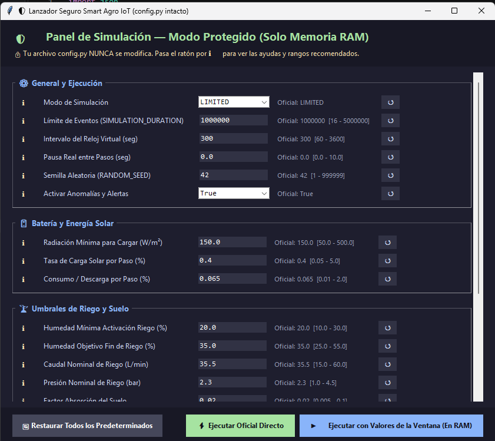
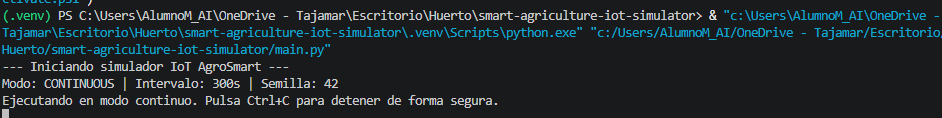
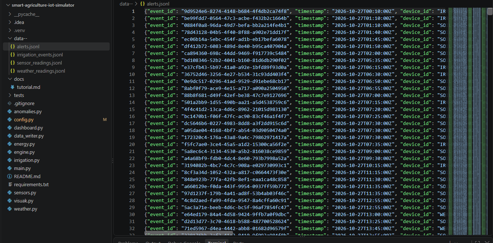
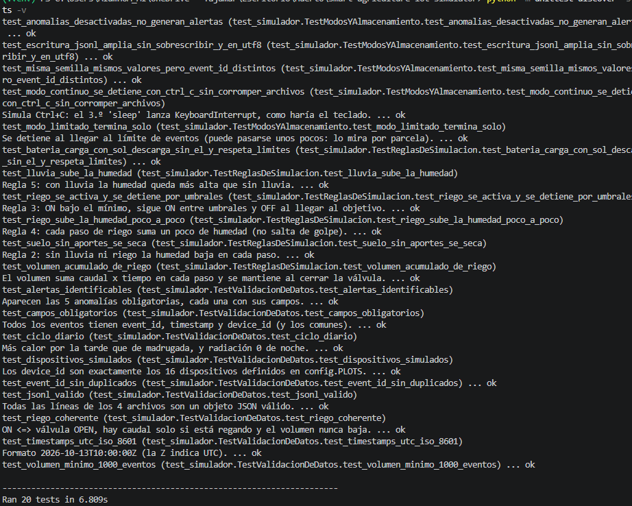
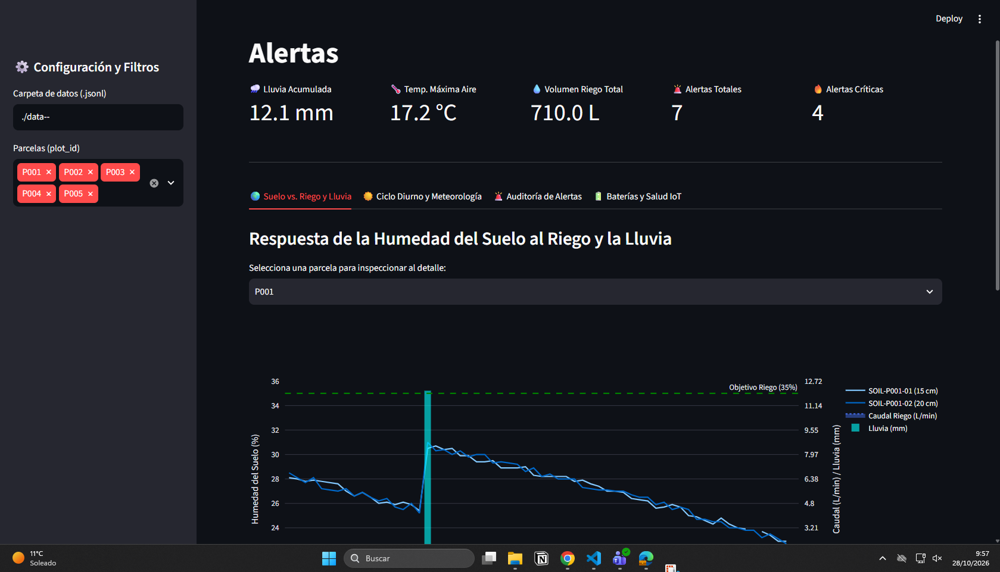

# Evidencias del Proyecto: Simulador de sensores IoT — Smart Agriculture

En este documento se recogen las capturas que evidencian el correcto funcionamiento del simulador, la generación de datos, la superación de las pruebas y la visualización de resultados.

## 1. Ejecución del script `engine.py`

A continuación se muestra la interfaz de configuración del simulador (Modo Protegido) y el registro de la consola al iniciar la ejecución del entorno.

**Configuración de ventana:**

**Consola de ejecución:**

## 2. Archivos JSONL generados

La siguiente imagen demuestra la correcta creación del directorio de salida (`data--`) con los 4 archivos requeridos, así como el formato interno (JSON Lines) con los campos obligatorios. 

**Directorio de salida y formato de datos (ejemplo con alerts.jsonl):**

## 3. Pruebas Unitarias

Captura que certifica la ejecución exitosa de todas las pruebas automatizadas (reglas de simulación, validación de datos, almacenamiento y anomalías).

**Ejecución de tests (`unittest`):**

## 4. Dashboard General

El panel de telemetría construido con Streamlit procesa con éxito los archivos `.jsonl` generados en tiempo real, permitiendo visualizar la evolución de la humedad, el riego y las alertas.

**Visualización del panel interactivo:**
